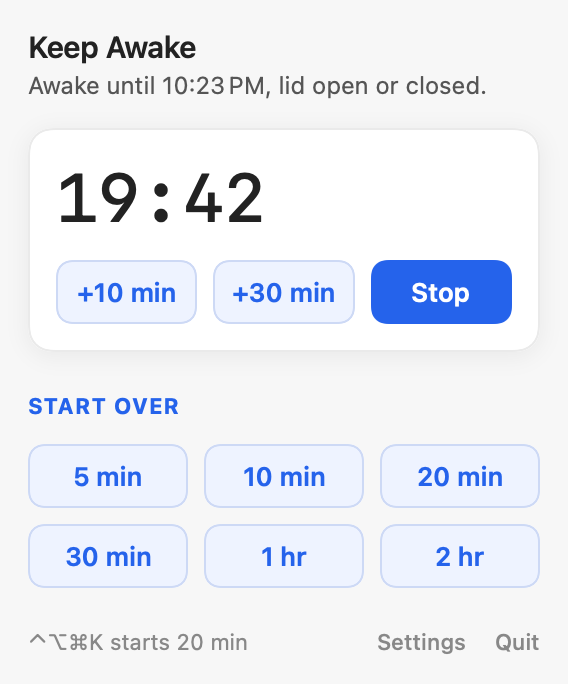
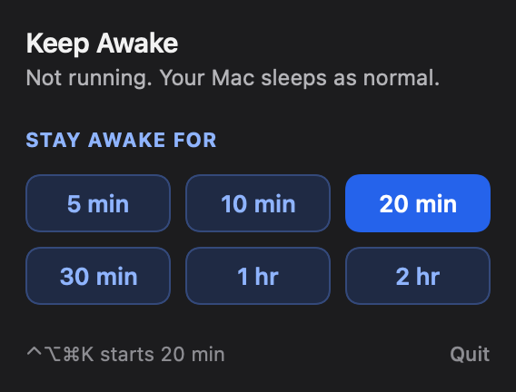

# Keep Awake

A small menu bar app that keeps a MacBook awake for a set time, with the lid open or closed. When the timer ends at a desk, the Mac stays awake.

<p>
  
  
</p>

## Why it exists

A MacBook sleeps when you close the lid. There is one exception: with an external display connected, macOS keeps the Mac awake so you can work with the lid closed. It does this with a hidden switch that says "don't sleep when the lid is closed."

Keep-awake apps use that same switch to keep a Mac awake with the lid closed. The switch is a plain on/off. It does not remember who turned it on.

That causes a bug. When an app's timer ends, the app turns the switch off. If you are at your desk with the lid closed, macOS still needed the switch on, so the Mac goes to sleep in the middle of your work. macOS does not notice the switch changed, so closing the lid keeps putting the Mac to sleep until the display next sleeps and wakes.

This was observed with Amphetamine 5.3.2 on macOS 26 on an Apple silicon MacBook. The kernel log shows the switch going off and the sleep starting in the same millisecond:

```
PMRD: setClamShellSleepDisable(2->0)
PMRD: sleep reason Clamshell Sleep
```

Keep Awake follows one rule to avoid this:

| When a session ends and… | Keep Awake… |
|---|---|
| the Mac is at a desk (mains power and an external display) | leaves the switch alone, because macOS is using it |
| the Mac is anywhere else | turns the switch off, so the Mac sleeps as normal |

If a session ends at a desk, Keep Awake remembers that it still owes the switch a turn-off, and does it once you unplug.

Mains power is part of the test on purpose. With the lid closed and nothing plugged in, macOS creates a stand-in display, so a display check alone would treat a Mac in a bag as a Mac at a desk.

## What it does

- Starts a session of 5, 10, 20, 30, 60 or 120 minutes from the menu bar.
- Shows the time left next to its icon.
- Keeps the Mac and its display awake during a session, with the lid open or closed.
- Lets you add 10 or 30 minutes, or stop early.
- Starts a session with a keyboard shortcut that you choose.
- Stops a session when the battery falls to 10%.
- Picks up a running session again if the app crashes.

It has no always-on mode, so the Mac cannot be left awake by accident.

## Install

You need macOS 13 or later and the Xcode Command Line Tools (`xcode-select --install`). Full Xcode is not needed.

```sh
git clone https://github.com/dewierwan/keep-awake.git
cd keep-awake
Scripts/install.sh
```

This builds the app, copies it to `/Applications/Keep Awake.app`, and starts it. Run the same script again to update.

The app is built and signed on your own Mac, so there is no download to trust and no Gatekeeper warning.

If you use a menu bar manager such as Ice, Thaw or Bartender, the new eye icon may start out hidden. Move it to the visible section.

If you used another keep-awake app with a lid-closed mode, quit it and stop it opening at login. Two apps flipping the same switch brings the bug back.

## Use

Click the eye icon in the menu bar and pick a length. Click a length again during a session to start over with that length.

The default keyboard shortcut is ⌃⌥⌘K. It starts a 20-minute session, or restarts one that is running.

You can also control the running app from a terminal:

```sh
alias keepawake="/Applications/Keep\ Awake.app/Contents/MacOS/KeepAwake"
keepawake --start 45   # start a 45-minute session
keepawake --stop
keepawake --status     # what the app sees: display, lid, battery, session
```

## Settings

Click **Settings** at the bottom of the panel.

- **Shortcut:** click it, then press the new shortcut. It needs Control, Option or Command, plus a letter or a digit. Delete removes the shortcut and Esc cancels.
- **Shortcut starts:** the length of the session the shortcut starts. Click to step through the lengths.
- **Open at login:** on by default.

- **Survive unplugging:** off by default. See the next section.

One setting has no button. On battery, a session stops when the charge falls to 10%. To change that level, or turn it off with 0:

```sh
defaults write com.dewierwan.keep-awake StopAtBatteryPercent -int 10
```

## Survive unplugging

Turn this on if you start a session at your desk and then unplug and walk away with the lid closed. Without it, the Mac sleeps the moment you unplug.

While a session runs, it blocks all sleep with `pmset disablesleep`, the system's own setting for that. When the session ends it allows sleep again. Blocking all sleep needs administrator rights, so turning the setting on asks for your password once and adds one line to the system's `sudo` rules, in `/etc/sudoers.d/keep-awake`:

```
yourname ALL=(root) NOPASSWD: /usr/bin/pmset -a disablesleep 0, /usr/bin/pmset -a disablesleep 1
```

That line lets your account run those two exact commands without a password, and nothing else. Turning the setting off removes the line.

While all sleep is blocked, the Mac will not sleep for any reason until the session ends. Keep Awake allows sleep again when the session ends or is stopped, when the battery reaches 10%, and when you quit. If it crashes, macOS restarts it and it carries on from where it was. To check or undo it by hand:

```sh
pmset -g | grep SleepDisabled          # 1 means all sleep is blocked
sudo pmset -a disablesleep 0           # allow sleep again
```

## Limits

- **Unplugging a display or charger during a session, with the lid closed, puts the Mac to sleep** unless you turn on Survive unplugging (below). macOS turns the lid switch off itself at that moment, and the sleep starts before any app can turn it back on.
- **The switch is undocumented.** It is `kPMSetClamshellSleepState` on the power management root domain, the same call other keep-awake apps use. A macOS update could remove it. If that happens, sessions stop keeping a closed Mac awake, and the Mac sleeps on lid close as normal.
- **Tested on one setup:** an Apple silicon MacBook on macOS 26 with a USB-C display that also supplies power.
- **A closed MacBook in a bag gets hot.** A session keeps it awake until the timer ends. Keep sessions short when the Mac is going in a bag.

## Uninstall

```sh
Scripts/uninstall.sh
```

This stops the app and removes the app, its login entry, its settings, and the Survive unplugging rule if you turned that on.

## How it is built

- `Sources/KeepAwakeCore` holds the logic with no system calls: the lid rule, time text and shortcut parsing. `swift run Checks` tests it.
- `Sources/KeepAwake` is the app: the kernel switch and sleep requests (`System.swift`), the session and its timer (`Session.swift`), the menu bar item and panel (`App.swift`, `PanelView.swift`, `PanelModel.swift`, `Theme.swift`), the login entry (`LoginItem.swift`), and Survive unplugging (`AllSleepBlock.swift`).
- `Scripts/build-app.sh` builds `build/Keep Awake.app`, and `Scripts/make-dmg.sh` packs it into a disk image. `Scripts/make-icon.sh` rebuilds the icon from `Resources/AppIcon.svg`.
- Pushing a tag such as `v1.2.0` runs `.github/workflows/release.yml`, which builds, signs, notarizes and publishes a release.

To check the switch on your own Mac, watch the kernel log while you start and stop sessions:

```sh
/usr/bin/log stream --info --debug --predicate 'eventMessage CONTAINS "setClamShellSleepDisable" OR subsystem == "com.dewierwan.keep-awake"'
```

`0->2` and `2->2` mean the switch is on. `2->0` means something turned it off.

## License

MIT. See [LICENSE](LICENSE).
